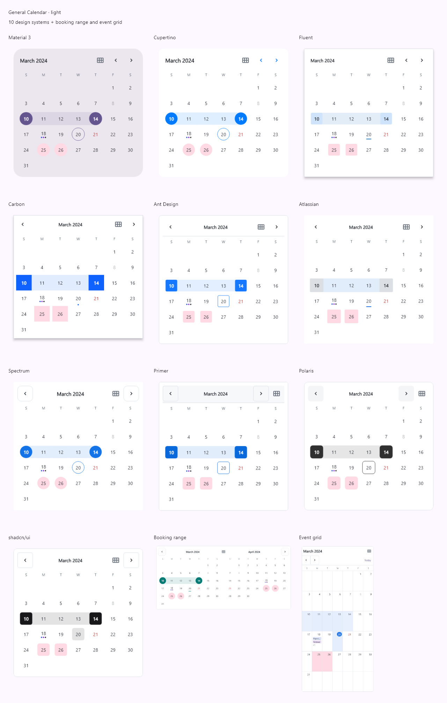
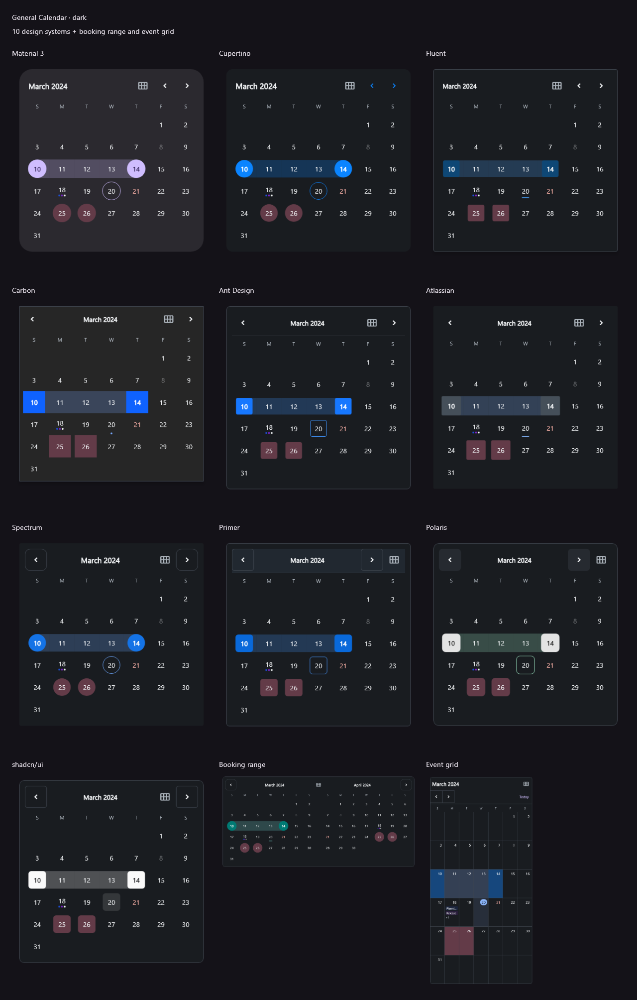

# Calendar designs

`GeneralCalendarDesign` provides ten design-system-inspired presets and two
additional calendar patterns. These are original Flutter adaptations of the
references below, not official ports or claims of full component parity. They
use the package's shared delegate, selection, date-rule, tag, builder, and
accessibility behavior. No brand assets or fonts are bundled.

## Reference catalog

| Preset | Primary reference | Implemented visual treatment |
| --- | --- | --- |
| `material` | [Material 3 date pickers](https://m3.material.io/components/date-pickers/overview), [official component guide](https://github.com/material-components/material-components-android/blob/master/docs/components/DatePicker.md) | Tonal rounded surface, circular days, outlined today, filled selection |
| `cupertino` | [Apple picker guidelines](https://developer.apple.com/design/human-interface-guidelines/pickers) | Inline calendar adaptation, prominent title, blue navigation, circular selection, quiet surface |
| `fluent` | [Microsoft Fluent calendar](https://github.com/microsoft/fluentui/tree/master/packages/react-components/react-calendar-compat) | Small rounded rectangles, pale selected fill, today underline, bordered elevated panel |
| `carbon` | [Carbon date-picker specifications](https://www.carbondesignsystem.com/building-blocks/core/components/date-picker/specifications) | Square contiguous cells, blue selection, today dot, split navigation, square surface |
| `antDesign` | [Ant Design DatePicker](https://ant.design/components/date-picker/) | Small blue selection rectangles, outlined today, divided header, split navigation |
| `atlassian` | [Atlassian calendar](https://atlassian.design/components/calendar/) | Quiet unbordered surface, neutral selection treatment, small corners, today underline |
| `spectrum` | [Adobe Spectrum calendar](https://react-spectrum.adobe.com/v3/Calendar.html) | Circular selection, outlined navigation controls, centered month heading, open surface |
| `primer` | [Primer DatePicker](https://primer.style/product/internal-components/date-picker/) | Rounded rectangular days, subtle header surface and divider, outlined navigation |
| `polaris` | [Shopify Polaris date picker](https://shopify.dev/docs/api/app-home/latest/web-components/forms/date-picker) | Neutral selection, rounded panel, filled navigation controls, medium corner radii |
| `shadcn` | [shadcn/ui calendar](https://ui.shadcn.com/docs/components/calendar) | Monochrome selection, bordered rounded panel, outlined navigation, muted today fill |

The Fluent reference is the calendar compatibility component, rather than a
Fluent 2 core Calendar component. Primer's documented DatePicker is internal to
GitHub; this package does not import that component. Apple's preset covers the
inline date calendar, not wheels or native UIKit. Atlassian's reference documents
a neutral selected-state treatment. Typography inherits the application's font.

## Additional popular patterns

| Preset | Reference | Implemented behavior |
| --- | --- | --- |
| `booking` | [react-dates](https://github.com/react-dates/react-dates) | Teal range selection, connected bands, and two consecutive month panels on wide layouts |
| `eventGrid` | [FullCalendar month view](https://fullcalendar.io/docs/month-view) | Bordered month cells, taller rows, top-aligned day numbers, visible date-tag labels, overflow count, and a Today toolbar button |

The booking preset supports all existing selection modes; choose `range` for a
booking workflow. Endpoints are inclusive, as everywhere in this package. There
is no built-in minimum stay or exclusive checkout date. The event grid shows
`CalendarDateAttributes.tags` as labels. It does not implement timed events,
event dragging/resizing, recurrence, resources, or external service connections.
All tag labels remain in semantics/tooltips when visual space limits display.

## Usage

```dart
GeneralCalendar(
  design: GeneralCalendarDesign.shadcn,
  firstDate: DateTime(2024),
  lastDate: DateTime(2026, 12, 31),
  onDateChanged: (date) {},
)

GeneralCalendar(
  design: GeneralCalendarDesign.booking,
  selectionMode: CalendarSelectionMode.range,
  firstDate: DateTime(2024),
  lastDate: DateTime(2026, 12, 31),
  onDateRangeChanged: (range) {},
)

final date = await showGeneralDatePicker(
  context: context,
  design: GeneralCalendarDesign.carbon,
  firstDate: DateTime(2024),
  lastDate: DateTime(2026, 12, 31),
);
```

Changing `design` preserves selected dates, displayed month, and view. Both
dialog helpers accept `design` and `visibleMonths`, and capture inherited
`GeneralCalendarTheme` overrides when opened.

`visibleMonths: 2` enables two panels for any preset. Booking requests two by
default. Below 760 logical pixels, or at the final allowed month, only one panel
appears. Week/year views always use one panel. The second month comes from the
delegate, including Hebrew leap/common-year differences. Adjacent-month filler
days are suppressed in two-panel layouts to avoid duplicate date controls.
Navigation advances one month at a time. Range bands follow RTL reading order.

## Customization and states

Theme layers resolve in this order: design preset, inherited
`GeneralCalendarTheme`, then the widget's `theme`. Only explicitly supplied
values override earlier layers. `design.resolve(Theme.of(context))` exposes the
resolved preset tokens for custom integrations.

```dart
theme: const GeneralCalendarThemeData(
  selectedDayColor: Colors.deepPurple,
  surfaceRadius: 16,
  dayRadius: 6,
  headerLayout: CalendarHeaderLayout.split,
  todayIndicator: CalendarTodayIndicator.dot,
  navigationStyle: CalendarNavigationStyle.outlined,
  dayHeight: 56,
)
```

Theme tokens also cover surface/foreground/muted/border colors, header text and
background, content padding, hover/focus fills, grid lines, event labels, and
weekend backgrounds. Presets resolve light/dark colors from the ambient theme.
Per-date colors and custom `dayBuilder` content remain available. All designs
retain disabled semantics, Material keyboard activation, and localized date
labels. Interactive day rows stay at least 48 logical pixels high; the visual
selection shape can be smaller. Very narrow hosts can reduce cell width.

## Preview and verification

The example has a style dropdown, dark-mode switch, and **Compare styles**.
The gallery keeps the selected chronology and its localization scope.





Images are rendered from the Flutter widgets. Rebuild using a local TrueType
font; it is loaded only for screenshots and is not copied into the repository:

```console
flutter test tool/render_design_previews.dart --dart-define=CALENDAR_PREVIEW_FONT=C:/Windows/Fonts/segoeui.ttf
```

The renderer writes one image per design/brightness and comparison sheets to
`docs/images/`. Ordinary tests do not require a system font. Tests cover all
presets, dark RTL layouts with enlarged text, selection persistence across style
changes, two-panel ranges and bounds, Hebrew transitions, week/year views, and
dialog theme inheritance. Minimum-SDK, native device, and browser execution have
not been verified. Pixel parity with the referenced components is not claimed.
