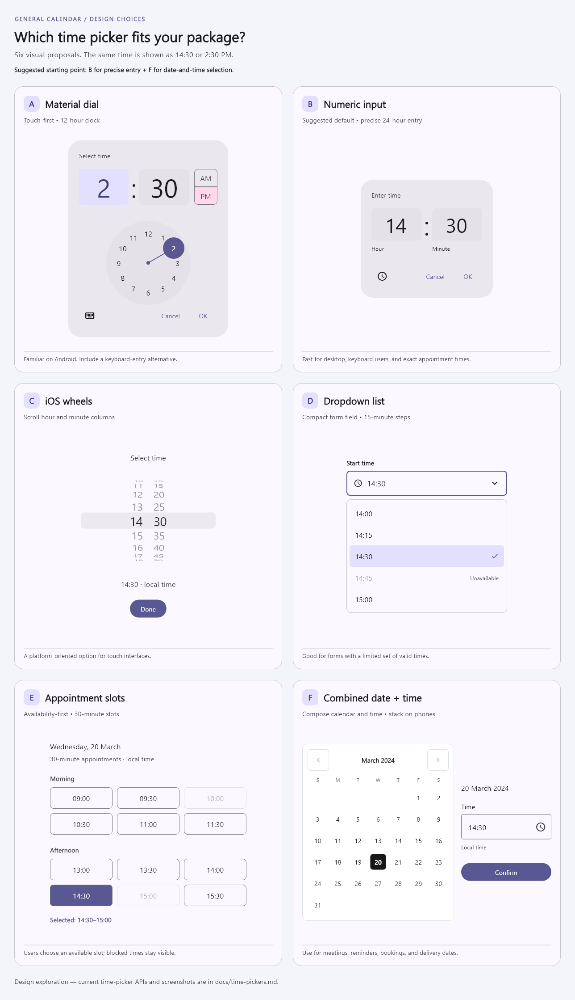
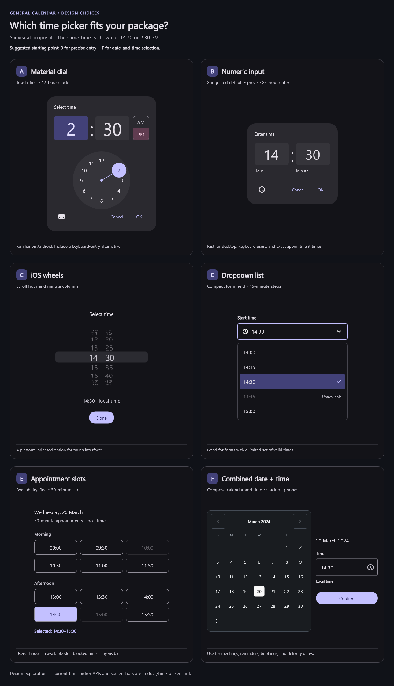

# Time picker options — decision preview

A time picker fits this package as an optional, composable UI component. A
date-time picker needs time input, but that input can be inline or entered by
keyboard; a separate time-picker dialog is not mandatory.

Keep date-only, time-only, and combined pickers independently usable. Calendar
delegates interpret the date. A time-of-day value does not need a different
implementation for Gregorian, Persian, Hijri, and Hebrew calendars. Combining
date/time values must preserve the date's calendar runtime type rather than
reconstructing a Gregorian DateTime from non-Gregorian calendar fields.

## Choose a UI

| Option | Pattern | Best fit |
| --- | --- | --- |
| A | Material dial with input switch | Touch-oriented Android-style interfaces |
| B | Numeric hour/minute input | Recommended baseline for exact, keyboard-friendly entry |
| C | iOS wheels | Platform-oriented touch interaction |
| D | Dropdown time list | Compact forms with fixed increments or valid-time choices |
| E | Appointment slots | Date-specific availability, duration, and disabled times |
| F | Calendar plus time input | Combined scheduling flow; stack sections on phones |

Recommendation: start with B, compose it with the existing calendar as F, then
add optional A/C presentations. Add E when appointment availability is in scope.
Styling and input pattern should be independent: the existing design presets
can eventually theme the time controls without duplicating their logic.

Useful future configuration includes 12/24-hour display, minute increments,
minimum/maximum times, a date-aware selectable-time predicate, disabled reasons,
locale digits, and a controlled value/callback. Scheduling timezone policies
belong in the application or a dedicated scheduling layer.

The API names are `GeneralTimePicker`, `showGeneralTimePicker`, and
`showGeneralDateTimePicker`. **These APIs are now implemented:** see the
[time-picker API guide and actual widget screenshots](time-pickers.md).

## PNG previews





The comparison uses real Flutter Material and Cupertino picker widgets for
A/B/C, custom visual proposals for D/E, and the existing GeneralCalendar for F.
It records the earlier design exploration. For the current interactive package
widgets, use the API guide linked above. All
options use the same example time: 14:30 / 2:30 PM.

References: [Material time pickers](https://m3.material.io/components/time-pickers/),
[Apple pickers](https://developer.apple.com/design/human-interface-guidelines/pickers),
and [Carbon date/time controls](https://www.carbondesignsystem.com/building-blocks/core/components/date-picker/specifications).

Regenerate using a local font (the font itself is not copied into the repo):

```console
flutter test tool/render_time_picker_options.dart --dart-define=CALENDAR_PREVIEW_FONT=C:/Windows/Fonts/segoeui.ttf
```

The tool writes the comparison sheets and separate A–F images in both brightness
modes to `docs/images/`. Rendering and analysis passed for these previews.
