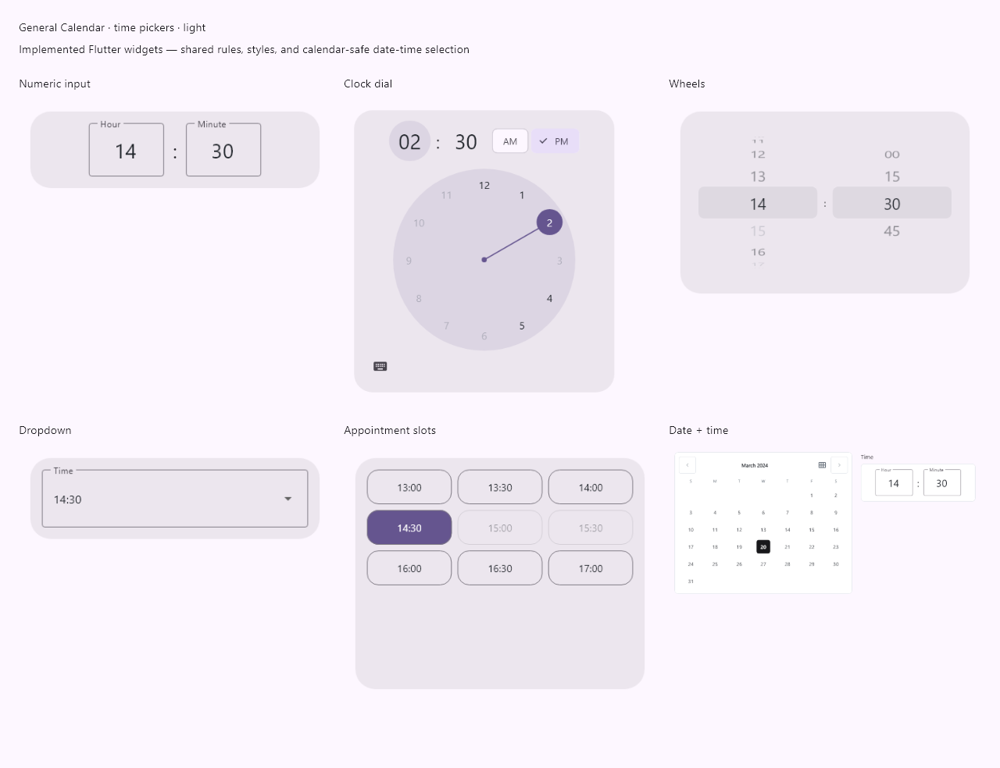
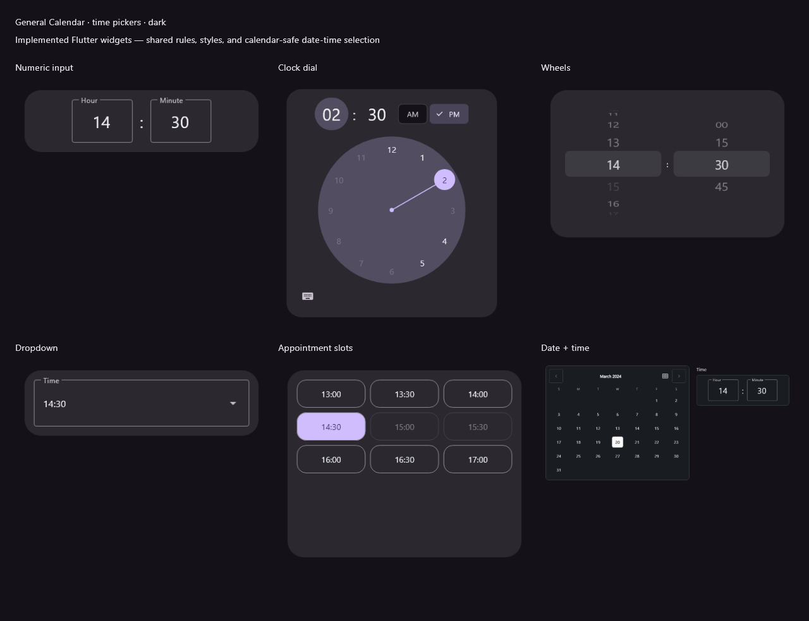

# Time and date-time pickers

The package provides independently usable time input and a combined date/time
picker. The runtime still depends only on Flutter.

| API | Role |
| --- | --- |
| `GeneralTimePicker` | Inline time-only input |
| `showGeneralTimePicker` | Time-only confirmation dialog; returns `TimeOfDay?` |
| `GeneralDateTimePicker` | Inline calendar plus time input |
| `showGeneralDateTimePicker` | Combined confirmation dialog; returns `DateTime?` |
| `GeneralTimePickerRules` | Shared time validation and interval choices |
| `CalendarDateTimeUtils.combine` | Calendar-preserving wall-clock composition |

## Time-only input

```dart
GeneralTimePicker(
  initialTime: const TimeOfDay(hour: 14, minute: 30),
  view: GeneralTimePickerView.input,
  use24HourFormat: true,
  minuteInterval: 15,
  minimumTime: const TimeOfDay(hour: 9, minute: 0),
  maximumTime: const TimeOfDay(hour: 17, minute: 0),
  selectableTimePredicate: (time) => time.hour != 12,
  design: GeneralCalendarDesign.shadcn,
  onTimeChanged: (time) {},
  onSelectionChanged: (validTimeOrNull) {},
)
```

`onTimeChanged` reports valid user selections. `onSelectionChanged` also reports
null when input is incomplete, malformed, off-step, out of bounds, or unavailable.
Use the nullable callback to gate form confirmation instead of retaining a stale
valid value. `onDraftChanged` additionally reports parsed unavailable values;
the combined picker uses this to retain a draft across date changes.

Callbacks describe edits, not initial construction. Initial values seed internal
state; change the key to reset them. Changing design/view preserves the draft.
Changing rules revalidates the displayed draft without silently substituting a
different time. Forms rebuilding with new external rules should revalidate their
stored value using `GeneralTimePickerRules.isSelectable`.

An unavailable initial draft is allowed, but dialog confirmation is disabled.
`readOnly` prevents interaction while retaining the visible value. Numeric input
accepts ASCII, Persian, and Arabic-Indic digits, plus the current Material
localization's decimal digits. The default 12/24-hour mode follows MediaQuery;
override with `use24HourFormat`. Standard field, AM/PM, and button labels use
MaterialLocalizations. Translate package-specific messages with
`GeneralTimePickerLabels`.

## Five input views

| View | Interaction |
| --- | --- |
| `input` | Hour/minute fields, with AM/PM controls in 12-hour mode; default |
| `dial` | Click, keyboard-activate, or drag clock positions; two hour rings in 24-hour mode; toggle to numeric entry for exact minutes |
| `wheels` | Scroll hour/minute columns; unavailable drafts cannot be confirmed |
| `dropdown` | Open a compact list of time choices |
| `slots` | Scroll a grid of appointment choices; unavailable times are disabled |

Choose 15- or 30-minute increments for dropdowns and appointment grids. The
default increment is one minute. `showUnavailableTimes: false` hides unavailable
entries in dropdown/slot views; wheels/dial still display their clock values.
Slots scroll to the initial draft when that choice belongs to the interval.
An empty availability window displays `noAvailableTimes`.

Bounds are inclusive, within one day. `minimumTime` defaults to 00:00 and
`maximumTime` to 23:59; reversed bounds throw ArgumentError. `minuteInterval`
must be positive and divide 60, so valid values are 1, 2, 3, 4, 5, 6, 10, 12,
15, 20, 30, and 60. Steps are anchored to minute zero of each hour. For an
overnight schedule, keep full-day bounds and use a predicate accepting the two
allowed portions of the day. All views use the same validation rules.

```dart
final time = await showGeneralTimePicker(
  context: context,
  initialTime: const TimeOfDay(hour: 14, minute: 30),
  view: GeneralTimePickerView.dial,
  minuteInterval: 15,
);
```

Dialogs return null on Cancel or dismissal and disable OK for invalid drafts.
They support locale/builder overrides, navigation route options, and captured
inherited calendar themes.

## Combined date and time

```dart
final result = await showGeneralDateTimePicker(
  context: context,
  firstDate: PersianDateTime(1400, 1, 1),
  lastDate: PersianDateTime(1410, 12, 29),
  initialDateTime: PersianDateTime(1403, 1, 1, 14, 30),
  calendarDelegate: const PersianCalendarDelegate(),
  design: GeneralCalendarDesign.shadcn,
  timeView: GeneralTimePickerView.input,
  minuteInterval: 15,
  use24HourFormat: true,
  selectableDateTimePredicate: (date, time) =>
      date.weekday != DateTime.friday && time.hour >= 9,
);
// result remains PersianDateTime (or null on cancellation).
```

Use `GeneralDateTimePicker` for the same behavior inline, with
`onDateTimeChanged` / nullable `onSelectionChanged`. Install matching Material
calendar localizations as described in the main README. The combined picker
retains disabled-date attributes, predicates, day builders, labels, week starts,
and all design presets.

`initialDateTime` seeds both controls. Alternatively, supply `initialTime` and
let the user choose a date. Supplying both is an error. Whole-day `firstDate` /
`lastDate` bounds are separate from optional exact `minimumDateTime` /
`maximumDateTime` bounds. Daily time rules intersect those exact bounds and the
date-aware predicate. Date changes reevaluate the retained time and invalidate
confirmation if necessary. A later date can make that same draft valid again.

At widths of 760 logical pixels or more, the time input sits next to the
calendar. Narrower hosts stack the controls. Dialog content scrolls when needed.
Confirmation requires both a selectable date and a valid time.

## Calendar and precision contract

Results have minute precision: seconds, milliseconds, and microseconds are zero.
Date-only normalization follows the calendar delegate, just like the existing
date picker. Flutter's Gregorian and the companion chronology delegates use
local date-only values, including when the initial date-time was UTC.

Composition does not reinterpret Persian/Hijri/Hebrew year/month/day as Gregorian.
`CalendarDateTimeUtils.combine` obtains native wall-date fields from the exact
epoch, constructs the requested UTC/local wall time, then adds the resulting
elapsed difference to the original calendar value. The four existing calendar
types preserve their runtime type through this operation. Used directly, the
utility also preserves the input's UTC/local mode.

Custom calendars whose `add` returns native DateTime must supply a
`CalendarDateTimeBuilder`. The combined picker checks that a custom builder
preserves the selected calendar type, date, UTC/local mode, and requested clock
fields while clearing seconds/fractions. Programming errors are propagated.

Native local DST gaps are rejected as unavailable times rather than silently
changing the requested hour. DST folds follow Dart's native constructor policy.
Named IANA zones, explicit fold selection, seconds entry, time ranges, and
state restoration are not provided by these APIs.

## Themes, example, and screenshots

Time pickers resolve the selected design, inherited `GeneralCalendarTheme`, and
widget `theme` in that order. Shared tokens such as `selectedDayColor`,
`selectedDayForegroundColor`, `todayColor` (accent), `rangeColor`, surface,
border, typography, and corner radii style time controls too.

The example contains an input-view selector, inline time picker, and time-only /
combined dialogs. Its combined dialog demonstrates date-specific availability.





These images render the public package widgets. Generate them with:

```console
flutter test tool/render_time_picker_previews.dart --dart-define=CALENDAR_PREVIEW_FONT=C:/Windows/Fonts/segoeui.ttf
```

The local font is loaded for rendering and is not bundled into the package.
Minimum-SDK and native device/browser execution remain unverified.
